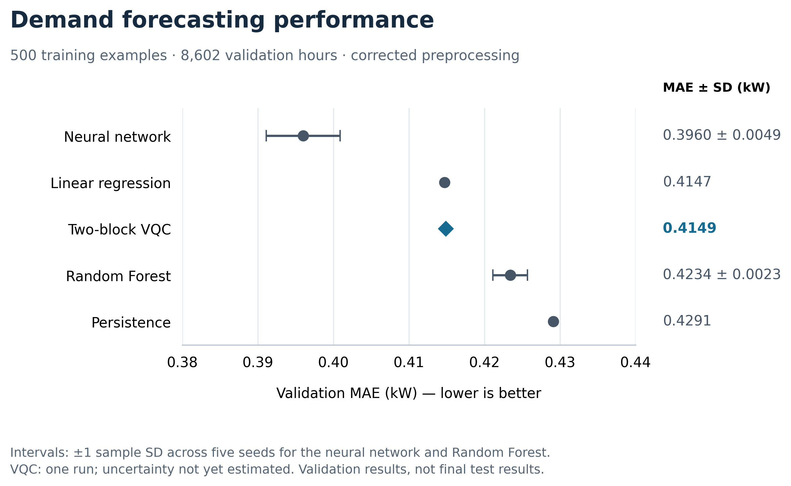

# Smart Energy Planner

**VQC demand forecasting and QAOA battery scheduling — undergraduate research in progress**

Ilias Moulouki · Computer Science, Artificial Intelligence specialization · Al Akhawayn University

This capstone investigates whether differences in demand forecasts translate into better battery-scheduling decisions in a small simulated solar–battery microgrid. Classical forecasting models provide reference performance for variational quantum regression. The planned scheduling study compares QAOA with exact solutions to the same small discrete problem.

## Current status

Forecasting, a classical battery simulator, and an exact discrete scheduler are implemented. The scheduler's 14 supplied tests pass. The binary encoding and diagonal cost model for QAOA are exhaustively verified; QAOA circuit training and integrated operational evaluation are **not yet implemented**. A documented synthetic classical example is available; no quantum advantage, measured household savings, or final test performance is claimed.

The notebook includes the exploration history and a corrected limited-data experiment. The corrected protocol uses 500 fixed training examples from 2007–2008, 8,602 validation examples from 2009, and preprocessing fitted exclusively on those 500 training examples. The 2010 test period remains reserved.

| Model | Validation MAE (kW) | Across-seed sample SD (kW) | Runs |
|---|---:|---:|---:|
| Persistence | 0.4291 | — | Deterministic |
| Linear regression | 0.4147 | — | 1 |
| Random Forest | 0.4234 | 0.0023 | 5 |
| Neural network | 0.3960 | 0.0049 | 5 |
| Two-block VQC | 0.4149 | Not yet available | 1 |

VQC seed 42 reached the 50-iteration limit: training MSE 0.4177 kW², runtime 478.4 seconds, no confirmed convergence. Two neural-network runs raised convergence warnings. Do not compare one VQC run with the classical averages as evidence of statistical superiority. The notebook uses statevector simulation, not quantum hardware.

## Research figures and tables

- [Figure 1 and supplementary figures](figures/README.md): descriptive filenames, numbered captions, and a vector PDF for the corrected comparison.
- [Tables 1–3: recorded forecasting results](results/README.md): summary, individual seeds, and training diagnostics.



Intervals show across-seed sample SD where five runs are available. VQC has one corrected run.

## Repository contents

- `src/battery_scheduler.py`: supplied battery simulator, no-battery baseline, and exact enumeration.
- `tests/test_battery_scheduler.py`: 14 supplied verification cases.
- `results/battery_scheduler_test_log.txt`: dated test output and runtime version.

- `notebooks/Smart_Energy_Planner.ipynb`: original code and stored outputs, with added section headings.
- `docs/PAPER_BLUEPRINT.md`: full paper outline, completed work, remaining methods, results placeholders, and diary template.
- `docs/ROADMAP.md`: four-week priorities and completion criteria.
- `docs/EXPERIMENT_LOG.md`: experiment summaries and limitations.
- `docs/NOTEBOOK_REVIEW.md`: review findings and reproducibility gaps.
- `docs/NOTEBOOK_PROVENANCE.json`: original upload fingerprint and cell mapping.
- `results/table_02_forecasting_results_by_seed.csv`: per-seed values transcribed from rounded printed outputs.
- `results/experiment_execution_log.txt`: stored stream outputs exported from the notebook.
- `figures/`: existing notebook figures; see their README for pilot labeling.
- `scripts/validate_notebook.py`: structural and Python syntax checks, without running training.
- `scripts/capture_environment.py`: record actual package versions in the runtime executing it.

## Verify the battery scheduler

From the repository root, run:

```bash
python3 -m unittest discover -s tests -v
```

The scheduler and tests use only the Python standard library. See [the scheduler review](docs/SCHEDULER_REVIEW.md) for supported behavior, defaults, and remaining validation gaps. These tests are implementation checks, not evidence of operational savings.

## Run in Google Colab

1. Open Google Colab and choose **File → Open notebook → GitHub** after the repository is uploaded, or upload the notebook directly.
2. Run cells in order. The notebook downloads UCI dataset 235 and installs its UCI and Qiskit dependencies.
3. Quantum runs can take several minutes each. A full run repeats exploratory training too; do not use Run all merely to inspect saved results.
4. Keep the final test period unused while developing methods.
5. Save the notebook back to the repository after meaningful milestones. Commit the updated results and document what changed.

The notebook's installation cells are currently unpinned. For a controlled rerun, use the dependency file and record actual installed versions before experimentation. The dependency file lists imported packages and pins the observed Qiskit version; it is **not** a complete environment lock.

## Local setup (optional)

```bash
python -m venv .venv
# Activate the environment using your platform's command.
python -m pip install -r requirements.txt
python scripts/validate_notebook.py
python scripts/capture_environment.py
```

Use a Jupyter-capable editor or install Jupyter separately to execute the notebook locally. Python 3.13 was reported in the original Colab environment; this package has not undergone a complete clean-environment rerun.

## Data and reproducibility

Demand comes from UCI's Individual Household Electric Power Consumption dataset (`fetch_ucirepo(id=235)`). Raw data are downloaded at runtime, not included in the repository. Verify the dataset citation and redistribution terms before including raw data elsewhere.

Original pilot preprocessing used the full training pool. Only the corrected section fits scaling on the selected 500 examples. Do not combine these protocols in a final-results table. Saved notebook outputs are evidence from the uploaded file; they were not regenerated while packaging this repository. Per-run CSV values are rounded and cannot replace full-precision exports from a live runtime.

## Four-hour scheduling example

[Scenario S01](docs/SCENARIO_01.md) includes assumptions, Table 4, Figure 2, and full-precision exports. Exact enumeration evaluates 625 schedules (68 feasible), obtaining a cost of 0.195 CU versus 0.295 CU for an idle battery. These are synthetic illustrative results, without forecasting or QAOA.

```bash
python scripts/run_scheduling_scenario.py
```

## Next milestone

Implement and independently check the QAOA cost-phase and mixer circuit, then run a small fixed-budget experiment. The [12-qubit binary encoding](docs/QAOA_ENCODING.md) now reproduces the S01 optimum across all 4,096 states. This is a dense diagonal simulator prototype, not an efficient QUBO construction. Forecasting improvements alone do not demonstrate energy-cost savings.

## Publication and licensing

This is a working research repository. A software license has not yet been selected. Dataset terms remain separate. GitHub reports this repository as public as of 3 November 2026. Supervisor publication approval has not been recorded here; confirm publication expectations with the supervisor. No visibility change was made during this audit.


### Test-period coverage and reporting

The reserved test set is the **available portion of 2010**, not a full calendar year. UCI describes the dataset as ending in November 2010 (https://archive.ics.uci.edu/dataset/235/individual+household+electric+power+consumption). Before final evaluation, export the exact first/last eligible timestamps, four-input row count, and monthly coverage from the processed data. Those processed endpoints and counts have not yet been audited. Report cost and energy over the observed interval, with per-day or per-kWh normalizations where appropriate; do not label partial-period totals annual savings or extrapolate seasonal performance to a full year.

### Evidence status

The initial 3 November audit did not have access to the separate scheduler files. Later that day, the author supplied `battery_scheduler.py` and `test_battery_scheduler.py`. They are now included under `src/` and `tests/`, unchanged from those uploads. All **14 tests passed** using `python3 -m unittest discover -s tests -v`; the dated output is saved in `results/battery_scheduler_test_log.txt`. This supersedes the earlier missing-code status. QAOA and integrated operational evaluation remain pending; the earlier claim of 12 tests is not used as evidence.

The rounded result CSVs are presentation transcriptions, not full-precision experimental artifacts. Export timestamp-aligned predictions, targets, model parameters, preprocessing state, and per-run diagnostics from the live experiment runtime; rerun only where those artifacts cannot be recovered. Recompute final statistics from these exports before final tables.

**Current numerical interpretation:** the single corrected VQC run (0.4149 kW) has lower MAE than persistence (0.4291), slightly higher MAE than linear regression (0.4147), and higher MAE than the five-run MLP mean (0.3960). The 0.0002 kW gap to linear regression does not establish equivalence or a statistically reliable difference.
