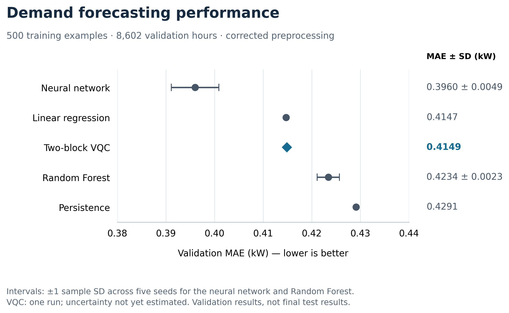
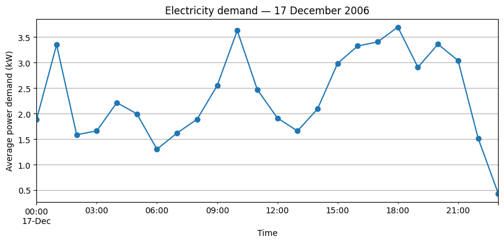
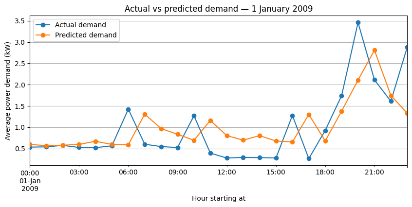
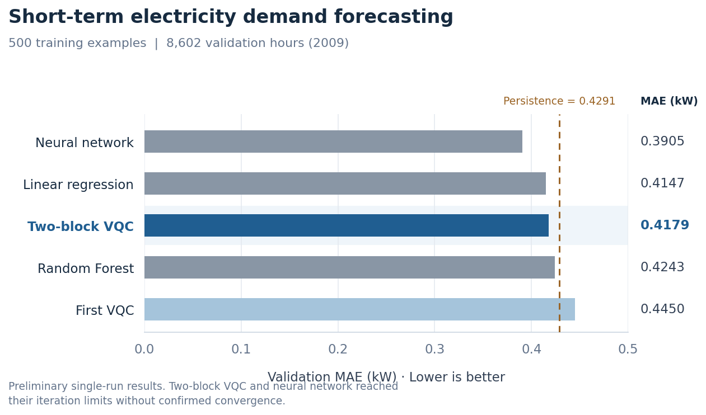
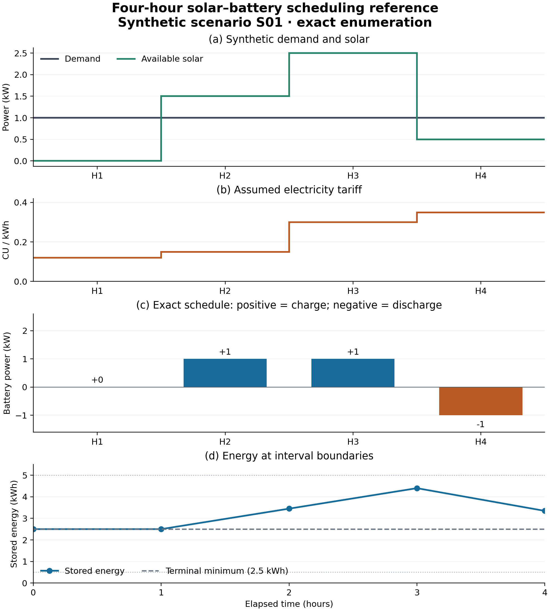
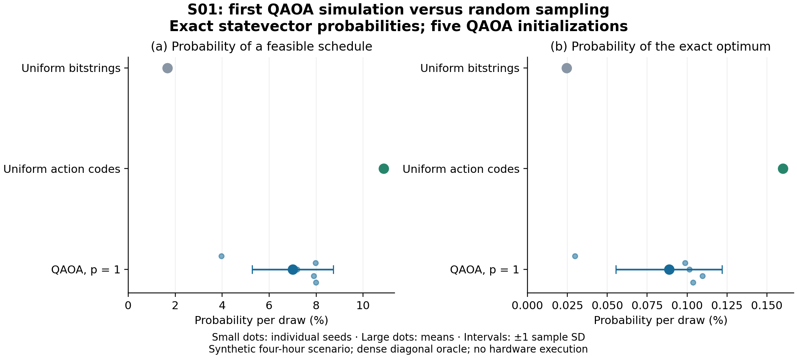

# Figures and captions

Figure numbers are provisional working-paper references. Supplementary figures preserve the exploratory record. Refer to figures by number in the manuscript and use descriptive filenames when inserting artwork.

## Figure 1. Validation forecasting performance

**Caption.** Forecasting performance under the corrected 500-example protocol, using the same selected training examples from 2007–2008 and 8,602 validation hours from 2009. Scaling for neural-network and VQC inputs was fitted exclusively on the selected training examples. Points show recorded MAE; intervals show ±1 sample standard deviation across five predefined seeds for the neural network and Random Forest. Linear regression and persistence are deterministic references. The two-block VQC point represents seed 42 only; no variability estimate is available. Two neural-network runs raised convergence warnings, and the VQC reached its 50-iteration limit. These validation results do not establish statistical superiority or quantum advantage.

[PNG](fig_01_validation_forecasting_performance.png) · [Vector PDF](fig_01_validation_forecasting_performance.pdf) · [Source table](../results/table_01_forecasting_performance_summary.csv)

Reproduce with `python scripts/plot_forecasting_results.py`.

## Figure S1. Household demand profile

**Caption.** Hourly mean household active-power demand on 17 December 2006. Hour labels indicate interval start times. This descriptive example illustrates intraday variation; it is not a forecast evaluation or a representative-performance claim.

Stored exploratory figure preserved without alteration. Provenance: original notebook cell 13.

## Figure S2. Linear-regression demand predictions

**Caption.** Observed and predicted hourly demand on 1 January 2009 for the exploratory two-input linear-regression model using previous-hour and previous-day demand. This single-day illustration is from the earlier experiment, not the corrected four-input limited-data comparison.

Stored exploratory figure preserved without alteration. Provenance: original notebook cell 31.

## Figure S3. Pilot forecasting comparison

**Caption.** Single-run validation MAE for the initial 500-example forecasting experiments. Neural-network and quantum inputs use the pilot scaler fitted on the full training pool. The dashed line represents persistence on the same validation rows. The two-block VQC and neural network reached their iteration limits without confirmed convergence. This pilot figure must not be presented as the corrected result in Figure 1.

Stored exploratory figure preserved without alteration. Provenance: original notebook cell 72.

## Figure 2. Four-hour exact battery schedule

**Caption.** Synthetic scenario S01: (a) assumed demand and available solar, (b) tariff in arbitrary currency units per kWh, (c) the exact discrete schedule, and (d) stored battery energy at interval boundaries. Positive power charges the battery; negative power discharges it. Enumeration evaluates 625 candidates, including 68 feasible schedules. The selected schedule costs 0.195 CU versus 0.295 CU with an idle battery under the same solar profile. This is an illustrative classical result, without forecasting or QAOA. The terminal minimum is 2.5 kWh; energy bounds are 0.5–5 kWh.

[Vector PDF](fig_02_four_hour_battery_schedule.pdf) · [SVG](fig_02_four_hour_battery_schedule.svg) · [Scenario and interpretation](../docs/SCENARIO_01.md) · [Table 4](../results/table_04_four_hour_battery_schedule.csv)

Reproduce with `python scripts/run_scheduling_scenario.py`.

## Figure 3. QAOA pilot probabilities versus random sampling

**Caption.** Exact ideal-statevector probabilities of (a) a physically feasible schedule and (b) the exact optimum for synthetic scenario S01. Small QAOA points show five initializations; large points are means and intervals are ±1 sample standard deviation, not confidence intervals. Random-baseline distribution probabilities are analytic and do not vary with seed. Uniform action-code sampling excludes unused binary codes but retains physically infeasible schedules. Four QAOA runs reached their 200-evaluation budget. This p=1 NumPy simulator pilot outperforms uniform bitstrings but underperforms uniform action-code sampling; it does not establish a quantum advantage. Probabilities are distinct from the observed 1,024-sample batches in Table 6.

[Vector PDF](fig_03_qaoa_pilot_probabilities.pdf) · [Table 6 CSV](../results/table_06_qaoa_pilot_by_seed.csv) · [Protocol and limitations](../docs/QAOA_PILOT.md)

Generated by `scripts/run_qaoa_pilot.py` from its saved per-run results.
